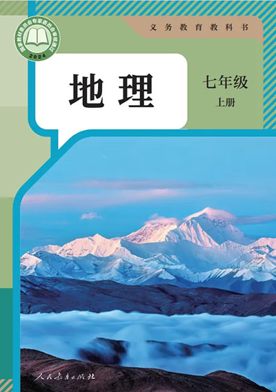
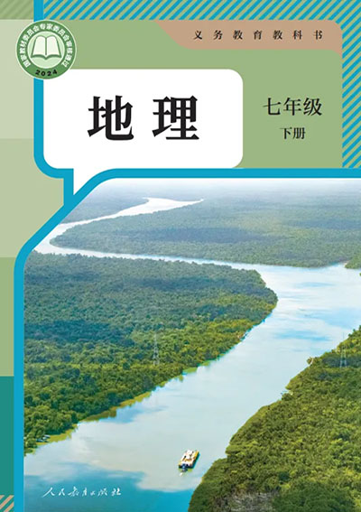
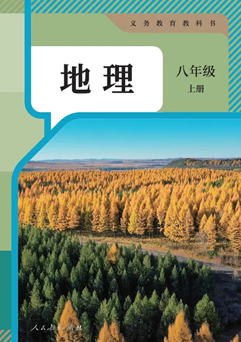
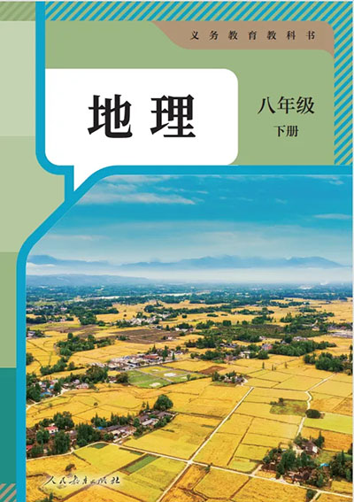
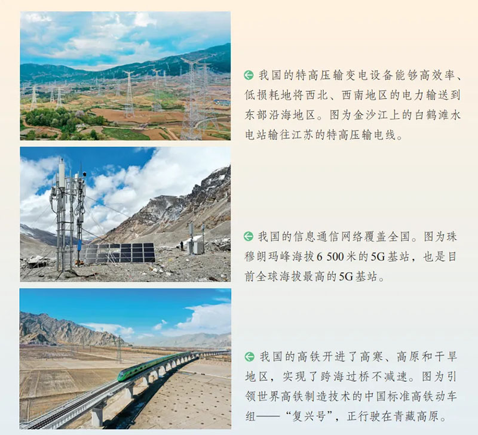
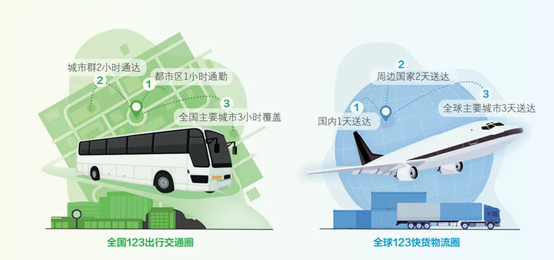
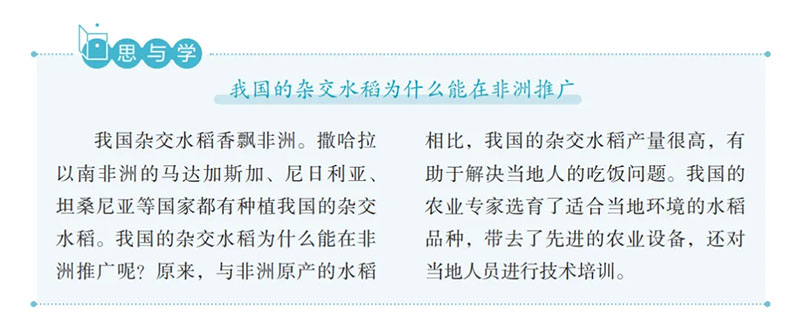
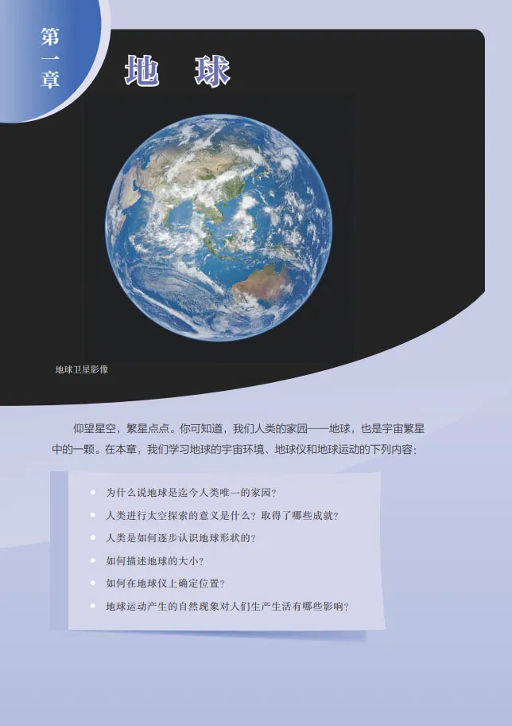
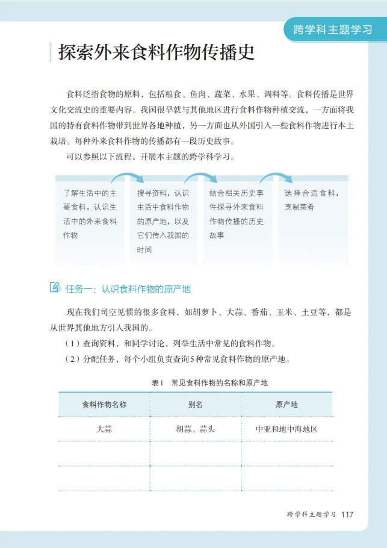
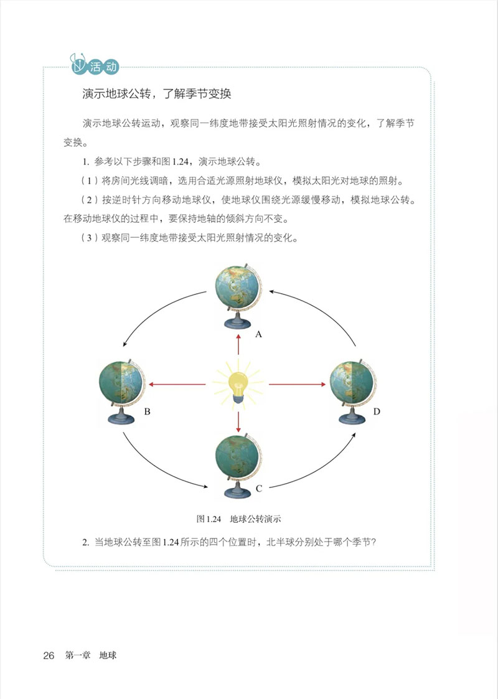

# 人教版义务教育地理（七～八年级）新教材介绍

> 来源：人民教育出版社官网（https://www.pep.com.cn/xw/zt/hd/12/xjcjs/cz/202409/t20240918_1995544.html）

**一、主编介绍**

　　自然地理学家、景观生态学家，中国科学院院士，第三世界科学院院士，中国科学院生态环境研究中心研究员、博士生导师、学术委员会主任，欧洲地球科学联合会“EGU洪堡奖章”得主。

　　中国科学院可持续发展研究中心主任、研究员，博士生导师，长期从事区域可持续发展、国土空间规划和综合人文地理学研究，在我国生态文明建设和优化国土空间发展格局中发挥着重要作用。曾任义务教育地理课程标准研制组组长，担任人教版多套地理教科书主编。

[人教社新教材介绍官方视频（MP4）](https://video.pep.com.cn/masvod/public/2024/08/21/20240821_1917395fcc2_r1_1200k.mp4)

　　人民教育出版社资深编辑、编审，长期从事基础地理教科书编写研究，为国家地理课程标准研制组核心成员，担任人教版《义务教育教科书 地理》副主编、《普通高中教科书 地理》主编。

**二、教科书介绍**

****

****

**（一）编写思路**

　　1. 凸显学科育人价值。教科书结合相关内容，精选国家重大发展战略、中华优秀传统文化等生动案例，介绍我国社会主义建设的伟大成就，培养学生爱祖国、爱家乡的情感，激发学生的民族自信、文化自信。

　　2. 全面落实课程标准要求。教科书编写以课程标准为依据，根据课程标准所列“内容要求”的变化而相应增加、删减、整合内容，把“认识家乡”的内容要求有机融入“认识中国全貌”和“认识分区”中。

　　3. 着眼学生地理核心素养的培养。教科书针对地理核心素养的养成采取多种策略：课文讲清楚与课程标准内容要求有关的基础知识，并设计“活动”，引导强化学生核心素养的培养；相关的地理观念、视角、技能和方法，通过“活动”和“思与学”来呈现。

　　4. 倡导以学生为中心的教学方式。教科书关注学生发展和社会需求，以地理素材与地理活动相结合的形式，形成融合基础性与时代性、学科性与生活性于一体的课程内容体系，为教学提供必要引导与改革空间。

　　5. 融入科学教育。教科书精选天文、地球运动、海洋等内容，利用多种方式，讲述人类探索自然的艰难历程，以期提高学生探索自然的兴趣。系统设计了古今中外科学家的头像及简介或事迹，培养学生的科学精神。

　　6. 体现时代特点。教科书内容全方位与时代对接，其中涉及人口、民族、经济等方面的内容，遵照中央最新表述。同时选择中华民族伟大复兴过程中科技创新等能反映时代特点的新案例。

  
图1 地理教科书中部分我国的成就举例

  
图2 地理教科书中我国发展目标举例

  
图3 地理教科书中我国在世界中的作用举例

**（二）编写体例（基本框架、编排方式）及栏目设置**

　　1. 基本框架

　　教科书将核心素养作为谋篇布局的纲领，以人地关系为主线，围绕综合思维、区域认知和地理实践力的培育组织课程内容，并将地理实践活动和地理工具的运用贯穿其中，形成将知识与活动融为一体的课程内容结构。总的来说，七年级教科书主要讲述世界地理，八年级教科书主要讲述中国地理。

　　2. 编排方式

　　以学生为主体，以核心素养目标为导向，积极探索教科书编写新思路。第一，图文配合详略得当，有效传递内容。第二，情境生动丰富，激发学生的学习兴趣和好奇心。第三，学科知识结构化呈现，可保证主干内容的逻辑性并开展个性化教学。第四，教科书版面适当留白，回应教师、学生需求，提升阅读教科书的心理体验与学习效果。

　　3. 栏目设置

　　教科书栏目主要包括“章首页”“活动”“思与学”“随图思考”“跨学科主题学习”。“章首页”图文结合，为开始学习新章节创设情境。“活动”栏目是培养学生地理核心素养的重要平台，包含明确的目的和思路，为教学提供引导。“思与学”以故事（事实）+问题+解释的三段式模式编写，给学生提供地理的基本观念、视角、思维和方法，供学生自学，也为教学提供弹性空间。“随图思考”在图边设置需要学生进一步思考的问题，引导学生读图并思考。“跨学科主题学习”通过流程提示、任务派送、说明和引导，帮助学生开展综合学习。

  
图4 地理教科书“章首页”设计举例

  
图5 地理教科书“跨学科主题学习”设计举例

  
图6 地理教科书“活动”设计举例

**（三）教科书的主要变化和特色**

　　1. 主要变化

　　重新调整教科书结构。根据课程标准内容要求，重组七年级上册和八年级上册的内容结构，突出课标内容的变化。

　　增加新栏目。“思与学”“跨学科主题学习”是全新的栏目，增强对学生地理核心素养等方面能力的培养，增加了教科书的弹性。

　　提升“活动”的引导性。每个“活动”均明确了主题、思路和价值，为教学提供充分的引导。

　　创新版式设计。教科书地图、素描图和景观照片均重新设计绘制，风格清新，重点突出，尤其是区域主图图幅加大，便利教学使用。

　　2. 主要特色

　　学科逻辑强。教科书在对学科逻辑深入研究的基础上，结合中学教学实际和课程标准的内容要求，搭建适合教学逻辑的内容结构。

　　课标要求落实充分。深入研究课标并认真落实每一条课程标准内容要求，除了内容结构基于课标，不同内容模块也反复强化课标的要求，充分体现地理课程的基本理念和育人要求。

　　文字精炼严谨、好读易懂。传承人教版地理教科书文字精炼严谨的传统，字斟句酌，反复打磨文字，确保表述科学严谨，以短句为主，符合中学生的阅读习惯和认知特点，做到易读好懂。

　　教学引导性强。教科书各栏目注重对教学环节的引导。“活动”给出明确的主题和素养培养的方向，设计层层递进的问题，提供必备的素材，为教学提供全面的引导。“思与学”精心设计问题，激发学生的好奇心、求知欲。“跨学科主题学习”给出具体的活动步骤，层层递进，指向明确，可操作性强。

　　适用性强。全套教科书的所有内容均进行了试教试用，覆盖了东中西部的不同类别学校，收到很多有益的反馈，提升了教科书的教学适切性。

**三、部分配套资源**

　　1. 教师教学用书（纸数融合资源，含教学课例、教科书音频、同步视频、图文拓展、学科工具等）

　　2. 《同步解析与测评 学考练》（纸质资源）

　　3. 《课时练》（纸质资源）

　　4. 《初中同步测控优化设计》（纸质资源）

　　5. 《同步轻松练习》（纸质资源）

　　6. 《能力培养与测试》（纸质资源）

　　7. 《人教金学典 同步练习册 同步解析与测评》（纸质资源）

　　8. 《初中地理学业考试试题笔记》（纸质资源）

　　9. 课标电子版、教科书电子版、课标解读、教科书介绍、教科书解读、教学设计、教学课件、教学微课、同步练习题（数字资源，登录人教网免费获取）

　　（注：教材内容以正式出版为准）
